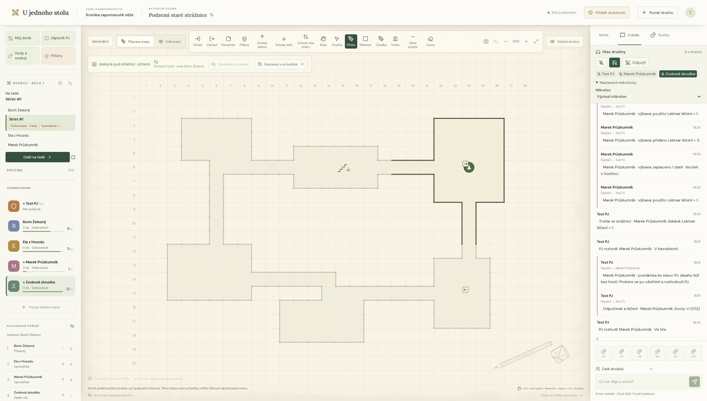

# U jednoho stolu

[](https://github.com/cert4u/u-jednoho-stolu/actions/workflows/ci.yml)
[](LICENSE)
[](CHANGELOG.md)
[](docs/DEVELOPMENT.md)
[](docs/SELF_HOSTING.md)
[](docs/VOICE.md)

**Český online herní stůl pro vlastní partu a společné fantasy dobrodružství.**

Parta kamarádů, čtverečkovaný papír, tužka a kostky. „U jednoho stolu“ přenáší atmosféru večerního hraní do prohlížeče: PJ připraví jeskyni, družina ji společně prozkoumává a příběh vzniká při hře. Mapa, deníky, hody i hlasový hovor jsou po ruce.

> V jednoduchosti je síla. Příběh vedete vy, aplikace pomáhá s mapou, evidencí a hody.

[Kompletní dokumentace](docs/README.md) · [Přejít k první hře](#jak-začít-hrát) · [Vlastní server](#vlastní-server-s-dockerem) · [Hlasové volání](#hlas-družiny) · [Plán projektu](docs/ROADMAP.md) · [Licence MIT](LICENSE)



*Ukázka testovací družiny: PJ vidí celou připravenou mapu, hráči pouze objevená místa. Vpravo je hlasový hovor se zvýrazněným mluvčím.*

## Pro koho je projekt určený

Pro menší partu, která chce hrát současně po večerech a mít společné místo pro své dobrodružství. Jeden hráč vede hru jako **Pán jeskyně**, ostatní hrají své postavy. Každý se připojí přes prohlížeč pomocí pozvánky; přístup ke své postavě si může obnovit osobním klíčem.

Vzhled a způsob hraní vycházejí z klasických českých fantasy her: kreslená mapa, postupné odhalování podzemí, pochodové pořadí a rozhodování PJ. Vlastnosti a bojové hody se inspirují DrD; konkrétní situace, následky kouzel a výjimky zůstávají na vaší domluvě a PJ.

Projekt je open source pod MIT a lze jej provozovat na vlastním serveru. Jde o aktivně vyvíjenou ranou verzi pro důvěryhodnou partu. Tento přehled popisuje hlavní vývojovou větev; změny ve stabilních vydáních najdeš v [historii verzí](CHANGELOG.md).

## Jak vypadá jeden večer

PJ připraví několik místností, poznámky, příšery a kořist. Hráči otevřou své deníky a připojí se k hovoru. Vedoucí družiny ukáže, kam skupina jde; za rohem se odkryje další část mapy a PJ dostane upozornění na připravené místo v blízkosti.

U podezřelých dveří přijde zkouška, při střetu hody na útok a obranu. PJ potvrdí následky a družina si po boji rozdělí nález. Objevená mapa, deníky i příprava zůstanou uložené na příště.

## Co už umí

### Čtverečkovaná mapa a průzkum

- Kreslení místností, chodeb, příček, dveří a schodišť. Překrývající se místnosti se spojí a obvod se přizpůsobí.
- Až osm propojených pater, značky vchodu a východu a zahájení dobrodružství u vchodu.
- Generátor V2 se styly hradního podzemí, dolu a přírodní jeskyně, logickým grafem místností, plánovanými průchody a automatickými dveřmi. Tři opakovatelné varianty, náhled a ruční úpravy; původní V1 je zachovaný pro staré seedy.
- Společný pohyb družiny, vedoucí a pochodové pořadí. Dohled respektuje zdi a zavřené dveře; navštívená místa zůstávají v šedé paměti.
- Posouvání papíru tažením, přibližování a přizpůsobení pohledu oknu.

### Příprava Pána jeskyně

- Příšery s číslovanými značkami, skrytými údaji, životy a vratnou archivací.
- Poznámky ukotvené v mapě: tajná příprava PJ a samostatně zveřejňovaný popis pro družinu. PJ dostane soukromé upozornění při přiblížení k místu.
- Zkoušky a pasti s výzvou konkrétnímu hráči, volitelně tajnou nebezpečností a ručním potvrzením následků.
- Tajná příprava kořisti, zveřejnění nálezu, přidělení hráčům a rovné rozdělení mincí se zachováním zbytku.
- Čas průzkumu, světla a odpočet doby svícení. Odpočinek a léčení s náhledem obnovovaných životů a magenergie.

### Postavy, kostky a souboj

- Deníky s pěti vlastnostmi, bojovými hodnotami, úrovní a zkušenostmi přidělovanými PJ.
- Výbava a měšec: položky, spotřeba kusů, příjmy, platby a převzetí kořisti do deníku.
- Vlastní kouzla a schopnosti, magenergie a její odečítání při použití. Účinky vyhodnocuje PJ.
- Hody generované na serveru: běžné kostky, hody na vlastnosti, útok a navazující obrana. Návrh zranění potvrzuje PJ.
- Soubojové pořadí, aktuální účastník a číslo kola. Vlastní stavy postav a příšer s ručně odečítaným trváním.
- Upozornění při nule životů a rozhodnutí PJ o vyřazení, bezvědomí, smrti nebo návratu do hry.

### Společný stůl a uložená hra

- Společný chat, soukromé šeptání a volitelný hlasový hovor pro každou družinu.
- Osobní obnovovací klíče, archivace a návrat postav.
- Úplná záloha kampaně včetně všech pater a tajné přípravy, s obnovou do nové místnosti.
- Ochrana rozepsaných formulářů a souběžných změn; uložení poznámky nepřepíše mezitím odečtené životy.
- Vlastní hosting přes Docker Compose, SQLite a správu instalace na `/admin`, včetně aktualizací ze stabilních vydání a návratu předchozí verze.

## Jak začít hrát

1. **Svolejte družinu.** PJ založí místnost a pošle pozvánku hráčům. Každý zadá jméno své postavy a přes avatar nahoře vpravo si uloží **obnovovací klíč**.
2. **Vyplňte deníky.** Zapište vlastnosti, bojové hodnoty, životy, výbavu a vlastní kouzla či schopnosti. Jejich účinky řešte podle svých pravidel.
3. **Připravte dobrodružství.** PJ mapu nakreslí nebo použije generátor, přidá příšery a poznámky. Nastaví vedoucího, dohled a umístí družinu, například tlačítkem **Umístit družinu u vchodu**.
4. **Připojte se k hovoru.** Je-li služba zapnutá, v panelu **Hlas družiny** zvolte **Připojit k hovoru**. Mikrofon je zpočátku vypnutý a každý si ho zapne sám.
5. **Prozkoumávejte.** Vedoucí kliknutím posouvá společnou družinu. **Ctrl + levé tažení** nebo nástroj **Ruka** posouvají papír; **Ctrl + kolečko** mění měřítko. Hráči uvidí postupně objevovaná místa a sdílené popisy.
6. **Nechte promluvit kostky.** Nabídka **Hody a souboj** slouží k hodům na vlastnosti, útok a obranu. PJ připraví pořadí souboje a potvrdí zranění. Do chatu lze napsat i vlastní hod, například `/hod 2k6+1`.
7. **Rozdělte nález a vraťte se příště.** Kořist převezměte do deníků. PJ může obnovit životy či magenergii a stáhnout úplnou zálohu kampaně. Běžné změny se ukládají průběžně.

Na mobilu najdeš společná nastavení v panelu **Družina, čas a patra**. Souboj má vlastní rozbalovací panel u mapy.

<details>
<summary>Další ovládání při hře</summary>

- **Stavy:** PJ je spravuje přes **Spravovat stavy** v hlavičce souboje. Počet kol odečítá ručně; nula stav sama neodstraní. Stavy automaticky nemění hody ani životy.
- **Kouzla a schopnosti:** v **Můj deník → Kouzla a schopnosti** nastav magenergii a vlastní záznamy s cenou. **Použít** odečte cenu a zaznamená použití pro hráče a PJ; oznámení celé družině je volitelné.
- **Odpočinek a léčení:** PJ v **Hody a souboj → Odpočinek a léčení** vybere postavy, určí obnovu, zkontroluje náhled a potvrdí ji. Potvrzené vyřazení, stavy a kola souboje se tím samy nemění.
- **Čas a světlo:** PJ eviduje světla a posouvá průzkumný čas. Odpočítávají se pouze rozsvícené zdroje se zadanou dobou. Poslední posun lze vrátit, dokud světla dál neupravíš. Dohled na mapě se nastavuje samostatně.
- **Poznámky:** nástrojem **Poznámka** klikne PJ na podlahu. **Uložit přípravu** zachová vše u PJ; **Uložit a sdílet popis** zveřejní nadpis a popis po odhalení místa. Běžné pozdější úpravy nezmění již sdílenou verzi. Hráči otevřou popis přes značku „i“.
- **Upozornění na místo:** výchozí dosah je 2 pole, nastavitelný na 1–6 nebo vypnutelný. Upozornění funguje i přes stěny, nic neodhaluje hráčům a během pobytu v okolí se neopakuje.
- **Přístupy a zálohy:** PJ může vydat hráči nový obnovovací klíč a archivovat nebo vrátit postavu. Obnova klíče odvolá starý herní token a vydá nový klíč. Úplná záloha obsahuje také tajnou přípravu; stahuje ji jen PJ. Obnova vytvoří novou místnost a nové přístupy, původní kampaň nepřepíše.

</details>

## Hlas družiny

Volitelný **LiveKit** přidává společné volání přímo k hernímu stolu. Každá družina má vlastní hlasovou místnost. K dispozici je mikrofon, ztlumení poslechu, výběr vstupního zařízení a označení účastníků i právě mluvícího.

Připojení začíná s vypnutým mikrofonem. Aplikace používá pouze hlas: vstupenky vydávané serverem povolují publikovat jen mikrofon. Kamera, sdílení obrazovky, nahrávání ani přepis nejsou součástí tohoto řešení. Šeptání v chatu nemění, komu je slyšet hlas.

Hovor zapíná správce instalace. Hra funguje i bez hlasové služby. Pro veřejné nasazení je potřeba HTTPS/WSS a síťové nastavení pro WebRTC; příslušný Docker profil a TURN popisuje [návod k hlasovému volání](docs/VOICE.md).

## Generátor jeskyně

**V2 je začleněný do hlavní větve `main`** ([PR #1](https://github.com/cert4u/u-jednoho-stolu/pull/1)). Nasazení ze zdrojů této větve používá nové rozhraní; původní V1 je v pokročilém nastavení. Aktualizátor v administraci nabízí pouze stabilní GitHub Releases, takže sloučení do `main` samo o sobě nevydává novou stabilní verzi. Při aktualizaci porovnávej i commit, nejen číslo verze.

PJ otevře **Generátor** nad mapou nebo **Generátor jeskyně** v zápisníku. Na mobilu je v panelu **Družina, čas a patra**.

1. Nastav název, styl, počet pater a místností, velikost a složitost. Pokročilá část obsahuje verzi algoritmu, seed, chodby a dodatečná propojení.
2. Zvol **Vytvořit náhled**; přepínačem prohlédni jednotlivá patra. **Varianta 1–3** vytvoří jiný reprodukovatelný návrh nad stejným seedem; nové semínko vytvoří novou sadu.
3. Potvrď **Vložit tato patra do dobrodružství**. Při existující mapě se přidají nová patra; zcela prázdné výchozí patro se využije pro první vygenerované patro.
4. V přípravě můžeš kresbu upravit. Pro zahájení průzkumu nastav vedoucího a umísti družinu; vygenerovaná kresba se hráčům sama neodhalí.

Celkem lze mít 8 pater po 28 × 20 polích. Na patro se vejde 2–12 místností, u velkých 2–6. Schodiště propojí nová sousední patra; případné propojení se starší mapou připraví PJ. Náhled obsahuje pouze mapu; příšery, pasti a kořist se připravují samostatně. Čísla místností a role pomáhají PJ v náhledu. V2 ukládá graf a původ generování soukromě; po strukturální ruční úpravě se graf označí jako neaktuální. Podrobnosti, audit a měření jsou v [technickém popisu generátoru](docs/GENERATOR_V2.md). První nové patro je přízemí s trvalou značkou vchodu; volba **Samostatný východ na přízemí** přidá druhou značku. Další patra vedou do hloubky.

V přípravě mapy nástroji **Vchod** a **Východ** klikni na podlahu. Na každém patře může být jedna značka každého druhu; dalším kliknutím ji přesuneš, gumou odstraníš. Tlačítko **Umístit družinu u vchodu** zahájí průzkum od vchodu zobrazeného patra. Samotné vložení značky družinu nepřesouvá. Východ je orientační značka, přechod do venkovní mapy zatím neprovádí. Hráči značky uvidí až po odkrytí; navštívená místa zůstávají v paměti mapy.

## Vlastní server s Dockerem

Pro vlastní server je od verze **0.2.0** připravený Docker Compose. Aplikace běží na Node.js 22 a ukládá data do SQLite v trvalém Docker volume. Cloudflare účet není potřeba.

Potřebuješ Linux s **Docker Engine 28+ a Compose v2**, Git a OpenSSL. Pro sestavení počítej přibližně se 2 GB volné RAM a několika GB místa na disku.

```bash
git clone https://github.com/cert4u/u-jednoho-stolu.git
cd u-jednoho-stolu
cp .env.example .env
openssl rand -hex 32
openssl rand -hex 32
```

Do `.env` vlož dvě různé vygenerované hodnoty jako `STUL_ADMIN_PASSWORD` a `STUL_UPDATER_TOKEN`. Nastav `PUBLIC_ORIGIN` na adresu své instalace; pro místní vyzkoušení použij `http://localhost:8080`.

```bash
chmod 600 .env
./deploy/stul.sh up -d --build
./deploy/stul.sh logs --tail=50
```

Pro místní vyzkoušení otevři [http://localhost:8080](http://localhost:8080). Na veřejném serveru nastav HTTPS reverzní proxy před výchozí adresu `127.0.0.1:8080`.

**[Podrobný návod pro Docker, HTTPS, zálohování a obnovu](docs/SELF_HOSTING.md)** popisuje také podporované prostředí a údržbu instalace.

### Aktualizace z administrace

Na adrese **`/admin`** se přihlas heslem správce instalace. Tento přístup je oddělený od role PJ a hráčů.

- Administrace nabídne poslední stabilní GitHub Release a odkaz na poznámky k vydání.
- Po potvrzení se sestaví image z přesného commitu vydání. Během sestavování lze dál hrát.
- Před výměnou se pozastaví změny a uloží záloha celé databáze. Pokud nová verze nenastartuje, updater se pokusí obnovit původní verzi i databázi.
- Ruční návrat předchozí verze obnovuje také její databázi; novější změny se před návratem uloží do další zálohy.

Pro další spouštění používej `./deploy/stul.sh up -d` nebo `./deploy/stul.sh restart`. Wrapper zachovává aktivní image po aktualizaci. Ze starého checkoutu znovu nespouštěj `up --build`. Samotný updater a zdrojový checkout se udržují ručně podle [návodu](docs/SELF_HOSTING.md#další-spouštění-compose).

## Lokální vývoj s Cloudflare

Vývojová varianta používá Workers a D1 emulované Wranglerem. Potřebuješ Git, npm a **Node.js 22.15 nebo novější**; Cloudflare účet pro místní vývoj není nutný.

```bash
git clone https://github.com/cert4u/u-jednoho-stolu.git
cd u-jednoho-stolu
npm run install:ci
npm run build
npm run db:init
npm run dev
```

Otevři [http://127.0.0.1:5173](http://127.0.0.1:5173). Databázové migrace se aplikují pouze na místní databázi a `db:init` lze opakovat. Data se ukládají do ignorovaného adresáře `.wrangler/state`.

Sestavenou verzi lze lokálně spustit přes `npm start` na portu 8787. Pro vývoj a integrační testy používáme `npm run dev` na portu 5173.

## Dokumentace a zapojení do projektu

| Chci… | Kde začít |
| --- | --- |
| Najít správnou příručku | [Rozcestník dokumentace](docs/README.md) |
| Hrát a připravovat dobrodružství | [Herní příručka pro hráče a PJ](docs/PLAYING.md) |
| Vyřešit problém nebo ověřit limit | [Řešení problémů](docs/TROUBLESHOOTING.md) a [limity](docs/LIMITS.md) |
| Provozovat vlastní herní stůl | [Vlastní hosting, HTTPS, zálohy a obnova](docs/SELF_HOSTING.md) |
| Zapnout hlasový hovor | [LiveKit a hlas družiny](docs/VOICE.md) |
| Podívat se na změny a další plány | [Historie verzí](CHANGELOG.md) a [plán práce](docs/ROADMAP.md) |
| Porozumět kódu | [Vývoj a architektura](docs/DEVELOPMENT.md) a [interní API](docs/API.md) |
| Připravit nové vydání | [Postup pro správce vydání](docs/RELEASING.md) |
| Přispět opravou nebo nápadem | [Pravidla přispívání](CONTRIBUTING.md) a [issues](https://github.com/cert4u/u-jednoho-stolu/issues) |

## Testování

```bash
npm run check:docs
npm run check
npm test
```

Pro všechny integrační testy spusť nejprve místní server:

```bash
npm run test:integration
# Volitelně jiná testovací instance:
npm run test:integration -- http://127.0.0.1:8787
```

Testy vytvářejí vlastní testovací místnosti. Míří na lokální testovací instanci; nepouštěj je proti své rozehrané produkční kampani. `npm run test:ci` spustí a po testech ukončí vlastní místní server. Předem vyžaduje sestavení a `npm run db:init`. GitHub Actions navíc ověřuje Node/SQLite variantu, přihlášení do administrace a skutečnou výměnu Docker kontejnerů včetně obnovy kampaně. Samostatné testy aktualizační logiky spustíš pomocí `npm run test:updater`; testy Node serveru a administrace pomocí `npm run build:node` a `npm run test:hosting`.

## Současná omezení

Úplný přehled technických i herních hranic je v [limitech](docs/LIMITS.md); při potížích začni [řešením problémů](docs/TROUBLESHOOTING.md).

- Mapa jednoho patra má 28 × 20 polí; okolní papír je prostor pro posouvání pohledu.
- Nejvýše 8 pater, 12 aktivních účastníků, 200 postav a 200 příšer včetně archivovaných.
- Nejvýše 200 poznámek na mapě v celém dobrodružství; jedna poznámka na políčko a patro.
- Nejvýše 50 připravených/otevřených nálezů a 100 uzavřených, po 24 položkách a 200 záznamech převzetí. Získaná výbava má nejvýše 200 názvů na postavu.
- Nejvýše 50 rozpracovaných zkoušek a historie posledních 100 uzavřených.
- Chat uchovává posledních 500 zpráv. Soubojové akce se ukládají samostatně.
- Synchronizace probíhá přibližně každé dvě sekundy.
- Bojové hodnoty se zapisují ručně. Automatické určování iniciativy podle pravidel, vyhodnocování účinků kouzel a schopností povolání ani individuální světelné zdroje zatím nejsou implementované.
- Úplná záloha verze 1 dovoluje nejvýše 3 MB serializovaných dat. Starý částečný zápis chatu nenahrazuje plnou zálohu.
- Obnovovací klíč je přístup k postavě. Nepřidávej klíče, herní zálohy ani databáze do repozitáře či veřejného issue.

## Licence a původ

Vlastní kód a dokumentace projektu jsou pod [licencí MIT](LICENSE). Převzaté součásti si zachovávají své původní licence a oznámení, viz [THIRD_PARTY_NOTICES.md](THIRD_PARTY_NOTICES.md).

Projekt vznikl jako neoficiální pomůcka inspirovaná původním českým hraním DrD. Nejde o produkt ani schválenou aplikaci nakladatelství ALTAR. Repozitář neobsahuje text pravidlových příruček, bestiář ani převzaté ilustrace. Licence k aplikaci neuděluje práva k cizím značkám nebo pravidlovým textům.

Základ hodů vychází z veřejných [zjednodušených pravidel ALTAR](https://www.tpro.cz/ppk/DrD_Lite-PH.pdf), která jsou odvozena od verze 1.6. Úplnou shodu se všemi pravidly 1.5 ani 1.6 aplikace neslibuje; výjimky a situace vyhodnocuje PJ.
