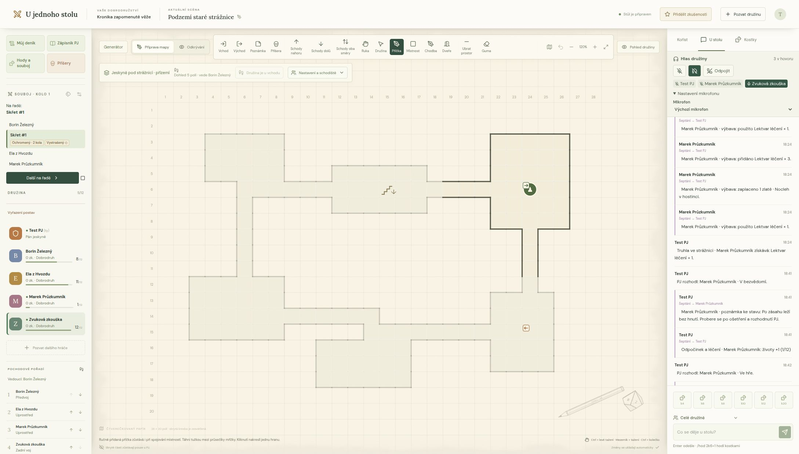
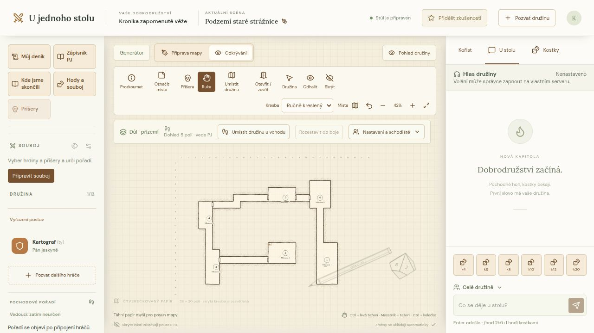

# U jednoho stolu

> „U jednoho stolu vzniklo pro všechny, kteří kdysi sedávali s kamarády nad čtverečkovaným papírem, házeli kostkami a společně prožívali dobrodružství. Dnes nás možná dělí stovky kilometrů, ale příběhy mohou pokračovat. Nechceme nahradit Pána jeskyně ani představivost hráčů. Chceme jim jen vrátit společný stůl.“

**Český online herní stůl pro vlastní fantasy družinu.** PJ nakreslí mapu, pozve kamarády a odkrývá podzemí krok za krokem. Deníky, kostky a volitelný hlasový hovor máte po ruce přímo v prohlížeči.

Vedle nástrojů jako Roll20 a Foundry má projekt užší cíl. Spojit dávné kamarády u jednoduchého stolu, který si jeden z nich spustí na vlastním počítači nebo serveru. Hra i data zůstávají u vás, bez cizího herního serveru.

[Jak začít hrát](#jak-začít-hrát) · [Vlastní server](#vlastní-server-s-dockerem) · [Dokumentace](docs/README.md) · [Poslední vydání](https://github.com/cert4u/u-jednoho-stolu/releases/latest)

*Skutečný herní stůl z pohledu PJ. Hráčům se mapa odkrývá podle toho, kam se družina vydá.*

## Jak vypadá jeden večer

**PJ připraví jeskyni.** Nakreslí si místnosti na čtverečkovaný papír nebo začne návrhem z generátoru. Přidá příšery, kořist a text Situace, který se družině rozvine nad mapou při vstupu do místnosti.

**Družina vyrazí.** Vedoucí ukáže, kam se jde. Zdi, zavřené dveře a volitelně i dosah pochodně určují, co je vidět. Prozkoumaná místa zůstanou zakreslená a zešednou, když se od nich družina vzdálí.

**Kostky rozhodnou o hodu, PJ o následcích.** U podezřelých dveří přijde zkouška, při střetu útok a obrana. Po hře zůstanou uložené deníky, objevená mapa i shrnutí pro příští večer.

## Co už umí

| U stolu | Při přípravě |
| --- | --- |
| Společný chat, soukromé šeptání a volitelné hlasové volání. | Ruční kreslení mapy, schodiště, více pater a generátor hradu, dolu či jeskyně. |
| Deníky, vlastnosti, výbava, měšec, zkušenosti a vlastní kouzla. | Příběhová osnova, tajné poznámky PJ a připravené popisy místností. |
| Hody, zkoušky, soubojové pořadí a rozestavení na mapě. | Ilustrovaný bestiář, kořist, nástrahy a stafáž mapy. |
| Společný průzkum, pochodové pořadí a dohled podle světla. | Na Node/Dockeru vlastní i komunitní katalogy a úplné serverové zálohy. |

[Herní příručka](docs/PLAYING.md) · [Herní mechaniky](docs/MECHANICS.md) · [Limity](docs/LIMITS.md)

## Generátor jeskyně

PJ si vybere prostředí, počet pater a místností. Prohlédne si varianty, vloží vybraný návrh a dokreslí ho na stejném papíru, který používá při hře. Výsledek lze zopakovat se stejným semínkem a nastavením. [Jak funguje generátor V2](docs/GENERATOR_V2.md)

## Jak začít hrát

1. **Svolejte družinu.** Jeden z vás založí stůl jako PJ a pošle pozvánku. Ostatní se připojí v prohlížeči a uloží si svůj obnovovací klíč.
2. **Otevřete deníky.** Zapište vlastnosti a výbavu. PJ mezitím připraví mapu nebo vybere dobrodružství z předlohy.
3. **Vyrazte od vchodu.** PJ umístí družinu a určí vedoucího. Ten kliknutím ukazuje, kam se skupina vydá.

[První hra a role u stolu](docs/PLAYING.md#role-a-přístupy) · [Začátek z předlohy](docs/PLAYING.md#začátek-z-předlohy)

### Hlas družiny

Na vlastním serveru může správce zapnout volitelný LiveKit. Každá družina má vlastní hlasovou místnost a připojuje se s vypnutým mikrofonem. V panelu lze mikrofon zapnout, ztlumit poslech a vybrat vstupní zařízení. [Nastavení hlasového hovoru](docs/VOICE.md)

## Vlastní server s Dockerem

Pro stabilní instalaci vyber tag z posledního vydání. Na Linuxu potřebuješ Docker Engine 28+, Compose v2, Git a OpenSSL. Návod tě provede nastavením `.env`, prvním spuštěním i HTTPS. Herní data a katalogové obrázky zůstávají v trvalém datovém volume. [Poslední stabilní vydání](https://github.com/cert4u/u-jednoho-stolu/releases/latest) · [První spuštění s Dockerem](docs/SELF_HOSTING.md#první-spuštění)

Pro malou družinu ber jako orientační základ 2 jádra nebo vCPU, 2 GB volné RAM a 5 GB volného místa pro instalaci a aktualizace. Místo pro kampaně a zálohy počítej zvlášť. [Požadavky a přístup pro družinu](docs/SELF_HOSTING.md#základní-požadavky)

V administraci na `/admin` můžeš zkontrolovat vydání, spustit aktualizaci a stáhnout úplnou serverovou ZIP zálohu. Přenosný export jednotlivé kampaně stahuje PJ přímo u stolu. [Aktualizace z administrace](docs/SELF_HOSTING.md#aktualizace-z-administrace) · [Dvě různé zálohy](docs/SELF_HOSTING.md#dvě-různé-zálohy)

## Dokumentace a zapojení do projektu

| Chci… | Kde začít |
| --- | --- |
| Hrát nebo vést dobrodružství | [Herní příručka](docs/PLAYING.md) |
| Spravovat katalogy nebo přidat vlastní obsah | [Správa katalogů](docs/CATALOG_LIBRARY.md) · [Návod pro autora](docs/CATALOG_AUTHOR.md) |
| Spustit projekt pro vývoj | [Node bez Dockeru](docs/DEVELOPMENT.md#rychlý-start-node-bez-dockeru) · [Lokální Cloudflare](docs/DEVELOPMENT.md#lokální-cloudflare-vývoj) |
| Přispět změnou nebo nápadem | [Pravidla přispívání](CONTRIBUTING.md) · [Issues](https://github.com/cert4u/u-jednoho-stolu/issues) |
| Najít všechny návody a technické podrobnosti | [Rozcestník dokumentace](docs/README.md) |
| Projít změny a další plány | [Historie verzí](CHANGELOG.md) · [Plán projektu](docs/ROADMAP.md) |

Pro základní kontrolu projektu spusť `npm run verify`. Pokyny pro integraci, Node hosting a Docker scénáře jsou ve vývojovém návodu. [Ověření a CI](docs/DEVELOPMENT.md#ověření-a-ci)

## Licence a původ

Vlastní kód a dokumentace jsou pod [licencí MIT](LICENSE). Převzaté součásti si zachovávají původní licence a oznámení. [Oznámení třetích stran](THIRD_PARTY_NOTICES.md)

Projekt je neoficiální česká pomůcka inspirovaná hraním Dračího doupěte 1.5. Dosavadní hody vycházejí ze zjednodušených pravidel ALTAR odvozených od DrD 1.6, edice E. Některé postupy jsou upravené pro online hru. O výjimkách a následcích při hře rozhoduje PJ. [Pravidlový základ a úpravy](docs/PLAYING.md#pravidlový-základ-a-úpravy)
