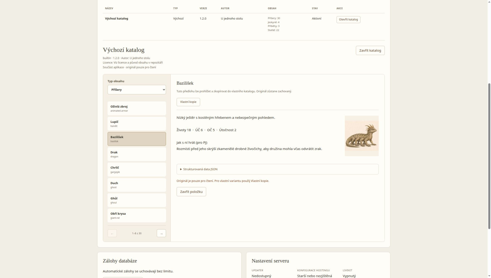

# Místní a komunitní katalogy

[Dokumentace](README.md) · [Autor katalogu](CATALOG_AUTHOR.md) · [Technické vyhodnocení](CATALOG_REPORT.md) · [Herní obsah](OBSAH.md)

Knihovna je součástí konkrétní instalace **Node/Docker**. Vlastní a již instalované komunitní katalogy fungují offline. GitHub je pouze volitelný distribuční kanál: aplikace při hraní nic nestahuje a nepotřebuje centrální účet.

## Správa instalace

Administraci otevírej na adrese běžící služby, například `http://localhost:8080/admin`; HTML soubor otevřený z disku serverovou správu neobslouží. Otevři `/admin`, přihlas se heslem správce instalace a přejdi do **Katalogy**. Herní přístup PJ ani hráče zde nestačí. Přehled ukazuje název, neměnné ID, typ, verzi, autora, počty položek, stav a dostupné akce. Otevřený katalog má vlevo seznam položek a vpravo popis a náhled; podrobné údaje jsou v rozbalovací části **Strukturovaná data JSON**. Seznam je stránkovaný po osmi položkách, bez vnitřního scrollbaru; šipky pod seznamem zpřístupní další položky. Vlastní kopii, duplikaci nebo odstranění najdeš u vybrané položky.

- **Výchozí:** soubory distribuované s aplikací. Bez databázového importu při startu, pouze pro čtení. Aktualizují se s aplikací.
- **Vlastní:** obsah správce v místní SQLite. Lze měnit metadata, přidávat a upravovat položky, kopírovat, exportovat a vracet uloženou verzi.
- **Komunitní:** ověřená místní kopie ZIP nebo veřejného GitHub zdroje. Originál je pouze pro čtení; vlastní variantu vytvoř přes **Vlastní kopie** do svého katalogu.

### Vytvoření a editace

1. **Vytvořit katalog:** zadej název, ID, autora a licenci. Nový katalog má verzi `1.0.0` a odkaz na distribuovaný obsah. Zobrazovaný název lze měnit v metadatech, ID zůstává stejné.
2. V přehledu otevři **Otevřít katalog**, vyber typ obsahu a **Nová položka**, nebo **Nový materiál**.
3. Editor používá existující schémata. JSON se kontroluje průběžně a server ověřuje i odkazy. U stafáže a příšery ukazuje náhled. ID existující položky neměň: **Duplikovat** založí nové ID, **Vlastní kopie** umí přenos mezi katalogy.
4. Obrázky přidávej jako statický WebP. Do pole `portrait` patří ID obrázku bez přípony. Vložené přílohy zůstávají v persistentním adresáři instalace.
5. **Uložit změny** kontroluje aktuální revizi katalogu. Pokud někdo mezitím uložil jinou úpravu, načti aktuální katalog; zastaralá změna jej nepřepíše.

Rozpracovaná data upravuješ ve **Strukturovaná data JSON**, které je u vlastního katalogu rovnou otevřené. U originálu pouze pro čtení zůstává JSON rozbalitelným technickým detailem vedle čitelného popisu a náhledu.

Pole jednotlivých kategorií popisuje [návod k obsahu](OBSAH.md) a [stafáž](SCENERY.md). Plošné materiály jsou záznamy `scenery` s profilem `surface`, ne pátá databázová kategorie. Smazání položky, která je použitá v kampani nebo potřebná pro jinou předlohu, je blokované. Kopie přebírají údaje o licenci a autorství zdroje; kopírování samo neuděluje nové distribuční oprávnění.

### ZIP a GitHub

**Importovat ZIP** otevře výběr souboru. Po jeho zvolení nejdříve zobrazí jméno, licenci, verzi, SHA-256, počty položek a závislosti. Teprve **Potvrdit instalaci** uloží celý katalog. Chyba nevytvoří napůl instalovanou knihovnu. Importovaný originál je komunitní a pouze pro čtení.

**Přidat katalog z GitHubu** otevře formulář přímo v administraci pro adresu a revizi; zrušení nic neinstaluje. Přijímá pouze veřejný `https://github.com/autor/repozitar`. Volitelně lze zadat tag nebo revizi; výchozí je `HEAD`. Server jej přeloží na konkrétní commit a stáhne archiv této neměnné revize. Nepracuje s živou větví během hry. Zdroj, commit, otisk a datum instalace zůstávají u katalogu.

U katalogu s GitHub zdrojem použij **Zkontrolovat aktualizace**. Souhrn porovná současnou a novou verzi a počet přidaných, změněných a odebraných položek. Stejné číslo verze s jiným obsahem má jiný otisk a vyžaduje nové potvrzení. Starší verze se neinstaluje jako aktualizace; slouží k tomu bod návratu. Chyba sítě nebo validace nemění platnou knihovnu. Aplikace sama aktualizace neinstaluje.

Podrobný [postup distribuce přes GitHub](CATALOG_GITHUB.md) popisuje konkrétní seznam změn, stav aktuálního obsahu, datum aktualizace a síťové limity. Shodný obsah nevytváří zbytečný návrh instalace ani bod návratu.

**Procházet komunitní katalogy** načte doporučený seznam z GitHubu projektu až na požádání. Seznam může být prázdný nebo nedostupný; místní knihovna funguje dál. Nejde o registr nutný pro hraní.

Posledních deset předchozích stavů každého katalogu tvoří body návratu. Návrat i aktualizace znovu ověřují závislosti. Vlastní katalog nelze přepsat aktualizací komunitního zdroje. Chceš-li z importovaného originálu vycházet, založ vlastní katalog a kopíruj vybrané položky.

## Použití ve hře a stabilita kampaní

Bestiář PJ, nabídka dobrodružství v lobby, předlohy generátoru a paleta stafáže používají společný resolver. Paletu lze načíst znovu tlačítkem **Obnovit katalogy**; při návratu do herního okna se nabídky také obnoví. Herní výpočty a algoritmus generátoru V2 se nemění.

Staré odkazy `kobold`, `castle` apod. stále znamenají vestavěný obsah. Nové položky používají `katalog:polozka`; typ je samostatnou částí klíče. Dva katalogy tedy mohou mít příšeru `rat`, aniž by se zaměnily. V přenositelné předloze jsou neoznačené odkazy místní; cizí odkaz je výslovný, například `builtin:castle`, a vyžaduje deklarovanou závislost.

Při prvním použití předlohy kampaň zachová její verzi a potřebné závislosti. Příšera dostane kopii herních údajů, dobrodružství vlastní místnosti a osnovu; zachované definice stafáže a materiálů drží jejich vzhled. Potřebné obrázky se uchovají přenositelně. Další použití stejné předlohy v této kampani vychází z připnuté verze. Nová kampaň použije aktuální knihovnu.

**Zakázat** skryje katalog z nabídky nových kampaní. Rozehrané kampaně mají své připnuté podklady a mohou s nimi pokračovat. Před odebráním se zobrazí použití; správce potvrdí zachování kopií v kampaních. Neúplné podklady nebo závislý katalog odstranění blokují. Připnuté kopie se odebráním knihovny nemažou.

Ve starých kampaních z doby před touto funkcí jsou původní ID zachovaná. Jejich tehdejší ilustraci nelze zpětně rekonstruovat, pokud ji původní instalace již změnila. Při skutečně chybějícím podkladu aplikace zachová ID a používá neutrální značku nebo údaj o nedostupné ilustraci; nevybere stejně pojmenovanou příšeru jiného katalogu.

Hráči nedostávají soukromou knihovnu ani celé připnuté předlohy. Dostávají pouze bezpečné vizuální definice skutečně známé stafáže a materiálů. Poznámky pro PJ a příprava dobrodružství zůstávají soukromé. Katalogové obrázky jsou datové soubory s adresou podle otisku, podobně jako stávající veřejné ilustrace; nepřidávej do nich tajné poznámky.

## Uložení a zálohy

Nová migrace `0001_catalog_library.sql` přidává SQLite tabulky `catalogs`, `catalog_versions` a `catalog_assets`. Staré SQL migrace se nemění. Knihovna je v databázi instalace; obrázky jsou neměnné soubory `STUL_DATA_DIR/catalog-assets/<sha256>.webp`. Výchozí obsah zůstává ve zdrojových souborech a distribučním balíčku. Zápis souboru se dokončí před potvrzením katalogu v transakci. Při neúspěšném importu může zůstat nepoužitá příloha, nikoli viditelný částečný katalog.

Navazující migrace `0002_catalog_updated_at.sql` přidává datum poslední změny obsahu, oddělené od data síťové kontroly. Již aplikované migrace zůstávají beze změny.

Rozlišuj tři exporty:

| Export | Obsah | Použití |
| --- | --- | --- |
| Katalog ZIP | Manifest, předlohy, obrázky, licenční dokumenty | Sdílení herního obsahu; neobsahuje kampaně ani přístupy. |
| Kampaň JSON formátu 1 | Herní stav a připnuté podklady včetně potřebných obrázků | Přesun jedné kampaně i bez původního katalogu a GitHubu. |
| Úplná serverová záloha ZIP | Konzistentní SQLite snapshot a neměnné katalogové obrázky | Přesun celé instalace a její místní knihovny. |

V administraci záloh použij **Úplná záloha ZIP**. Nový snapshot ukládá také soubor příloh vedle `.sqlite`; updater při retenci odstraňuje oba. Starý přímý endpoint SQLite zůstává pro kompatibilitu, ale samotná databáze není úplná záloha obrázků. Připnuté obrázky jednotlivých kampaní jsou navíc přímo v jejich JSON stavu.

Tvorba snapshotu i export úplného ZIP ověřují dostupnost a otisky příloh potřebných pro jeho katalogy a uloženou historii. Pokud chybí soubor příloh, některý potřebný obrázek nebo nesouhlasí jeho otisk, operace selže místo nabídnutí neúplné zálohy. Existující snapshot se kontroluje proti své vlastní databázi; jeho export nevyžaduje současný obsah živého adresáře obrázků. Staré snapshoty bez katalogových příloh zůstávají podporované.

Při ruční obnově serverového ZIP zastav instalaci, uschovej dosavadní celý datový adresář, vrať `game.sqlite` a adresář `catalog-assets` ze **své důvěryhodné zálohy** do datového volume a oprav vlastníka souborů pro uživatele kontejneru. Potom spusť aplikaci a ověř knihovnu i testovací kampaň. Neobnovuj živou SQLite přepisem běžícího souboru. Instalační hesla a `.env` uchovávej samostatně bezpečným způsobem.

Aktualizace a lokální rollback kontejneru používají SQLite snapshot a tentýž persistentní adresář neměnných obrázků. Obrázky se při odebrání katalogu ani návratu automaticky nemažou, takže starší verze a připnuté podklady neztratí soubory. Záloha kampaně zůstává ve formátu 1 s volitelným `contentLibrary`; staré zálohy bez tohoto pole jsou čitelné. Nové zálohy obnovuj aplikací, která připnuté katalogy podporuje.

## Limity a bezpečnost

- Nejvýše 16 místních/komunitních katalogů a deset předchozích stavů každého katalogu.
- Katalog: 200 příšer, 32 předloh jeskyní, 50 dobrodružství, 200 záznamů stafáže/materiálů, 200 obrázků.
- ZIP32: nejvýše 40 MB vstupu, 32 MB rozbalených dat, 700 souborů. Podporované jsou uložené a deflate archivy; šifrování, ZIP64, symlinky, speciální a spustitelné soubory jsou odmítnuté. Nic se nerozbaluje do zdrojového adresáře.
- Jedna JSON položka do 256 kB, manifest a každý doprovodný text do 64 kB. Povolené doprovodné dokumenty: `README.md`, `LICENSE`, `LICENSE.txt`, `.gitignore`; pouze jako text.
- Statický WebP do 1,5 MB, nejvýše 2048 × 2048 bodů, bez animace a EXIF/XMP metadat. Povolená je i průhlednost a ICC profil. Kontroluje se RIFF struktura, rozměry, délky a otisk.
- Persistentní přílohy nejvýše 128 MB a 4096 souborů včetně zachovaných starších podkladů. Plný adresář nemaž bez kontroly závislostí starých kampaní a snapshotů.
- Připravené importy: nejvýše dva návrhy na instalaci, platnost pět minut. Po vypršení připrav nový náhled.
- GitHub: pouze pevné HTTPS endpointy `api.github.com` a `codeload.github.com`, bez tokenu a přesměrování, s časovým a velikostním limitem. Libovolné servery, interní adresy a soukromé repozitáře nejsou podporované.
- Kampaň má nejvýše 512 připnutých položek a 2,4 MB připnutého obsahu; nadále platí celkový limit JSON zálohy 3 MB. Příliš velké obrázky je potřeba zmenšit před použitím.
- Přenosná serverová záloha má limit 128 MB na samotnou SQLite databázi a 256 MB celkem. Větší instalaci zálohuj konzistentní kopií celého datového volume při zastavené službě.

Zod schémata se sdílí se stávajícím obsahem. Kontrolují se odkazy, jedinečnost ID a cykly závislostí. CRC a omezená dekomprese chrání čtení ZIP, názvy nejsou cestami pro zápis. Stafáž používá jen ověřené SVG příkazy a barvy, žádný kód či externí SVG. Texty se zobrazují jako text, ne jako HTML. Administrace používá stávající relaci, kontrolu původu a ochranu údržby.

## Node/Docker a Cloudflare

| Prostředí | Podpora |
| --- | --- |
| Node/Docker | Persistentní knihovna, administrace, ZIP, veřejný GitHub, potvrzené aktualizace a historie. |
| Cloudflare | Dosavadní vestavěné katalogy a připnuté podklady přenesené zálohou; dynamická serverová knihovna není podporovaná. |

Společné moduly neimportují Node filesystem. Node adaptér se připojuje přes runtime binding a samostatně sestavenou validační knihovnu pro existující administraci. Pro Cloudflare lze později přidat skutečný adaptér; tato verze jeho existenci nepředstírá.

Technické formáty: [ZIP APPNOTE](https://pkware.cachefly.net/webdocs/casestudies/APPNOTE.TXT) a [WebP RIFF](https://developers.google.com/speed/webp/docs/riff_container). Implementace záměrně podporuje jen výše popsanou omezenou datovou podmnožinu.

### Neuložené položky ve stabilizační větvi

Při opuštění vlastní rozepsané položky (jiná kategorie, položka, metadata, zavření editoru/katalogu) se nejprve zobrazí potvrzení. Zrušení zachová JSON i původní kategorii. Nová dosud neuložená položka se také považuje za rozepsanou. Stránkování seznamu nemění rozepsaný editor. Pomalá operace blokuje druhé odeslání a opožděné odpovědi předchozího přihlášení se po odhlášení nepoužijí. Výchozí a komunitní originály zůstávají pouze pro čtení; jejich úpravy patří do vlastní kopie.
