# Klasický a ručně kreslený vzhled mapy

V liště mapy je volba **Kresba → Klasický / Ručně kreslený**. Výchozí je klasický vzhled. Přepnutí mění pouze prezentaci: poloha, zoom, nástroj i rozpracovaný tah zůstávají zachované. Klíč `stul-map-appearance` v localStorage nepatří do stavu kampaně, API ani záloh. Bez dostupného localStorage funguje přepínání v aktuálním okně.

## Vizuální srovnání

Skutečné snímky SVG v prohlížeči, vždy stejná geometrie a přiblížení uvnitř dvojice. Generované příklady používají V2, šest místností, jedno patro a semínka `ink-visual-castle`, `ink-visual-mine`, `ink-visual-cave`. Ruční příklad nemá metadata. Snímky ukazují pohled PJ s odhalenou podlahou; čísla jsou soukromé značky místností.

| Příklad | Klasický | Ručně kreslený |
| --- | --- | --- |
| Hrad: pravidelnější kontury a drobné kamenné spáry | 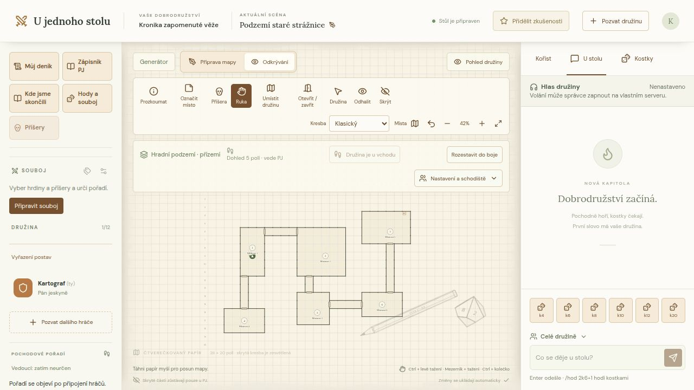 | 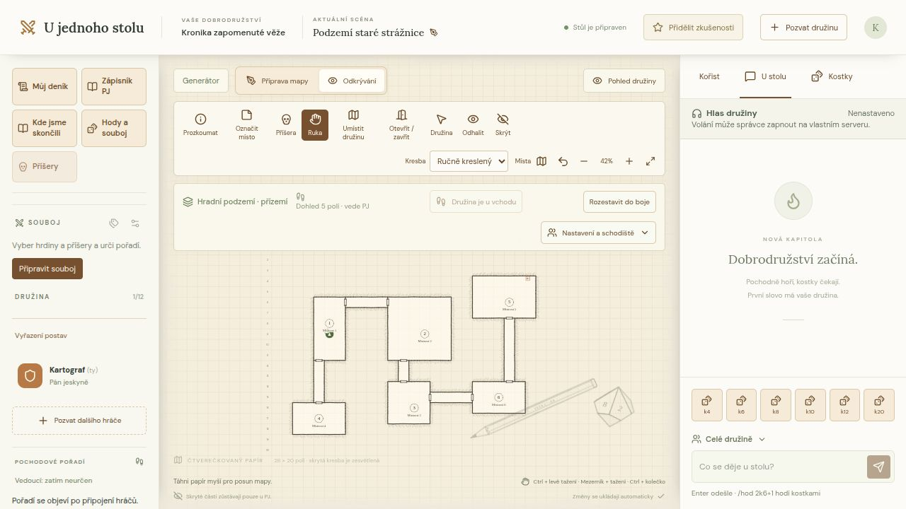 |
| Důl: hrubší linie a párové skalní tahy | 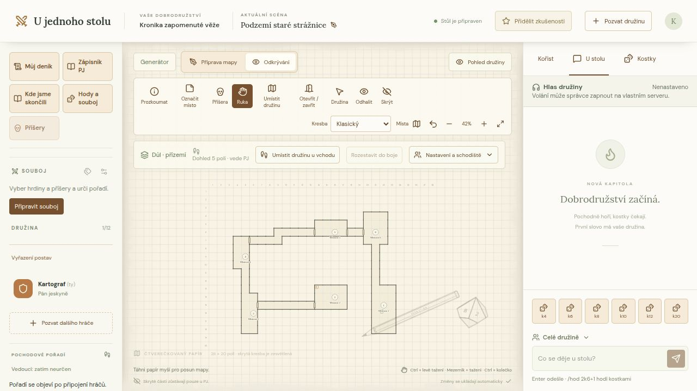 | 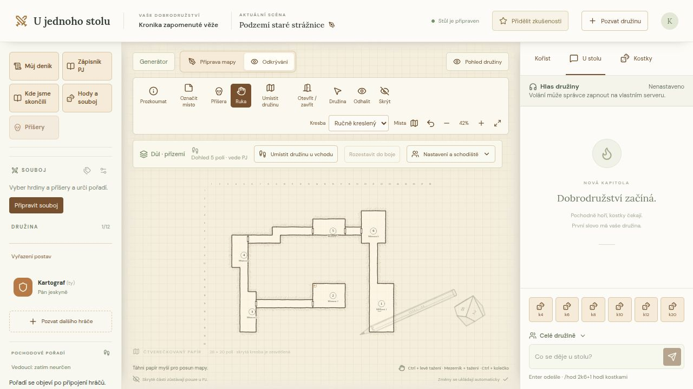 |
| Jeskyně: nepravidelnější linie a krátké skalní šrafy | 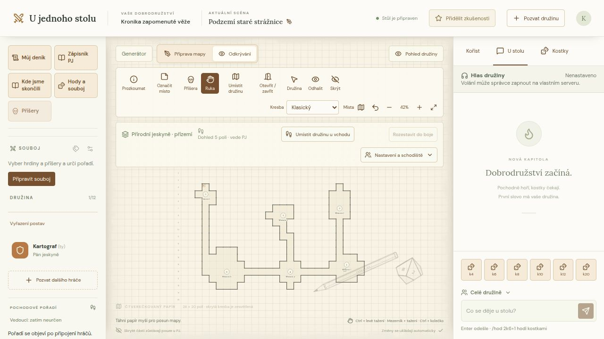 | 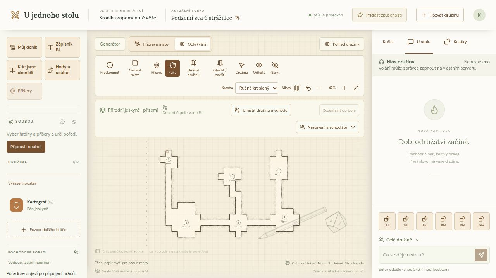 |
| Ruční mapa: univerzální rukopis, příčka bez jednostranných šraf | 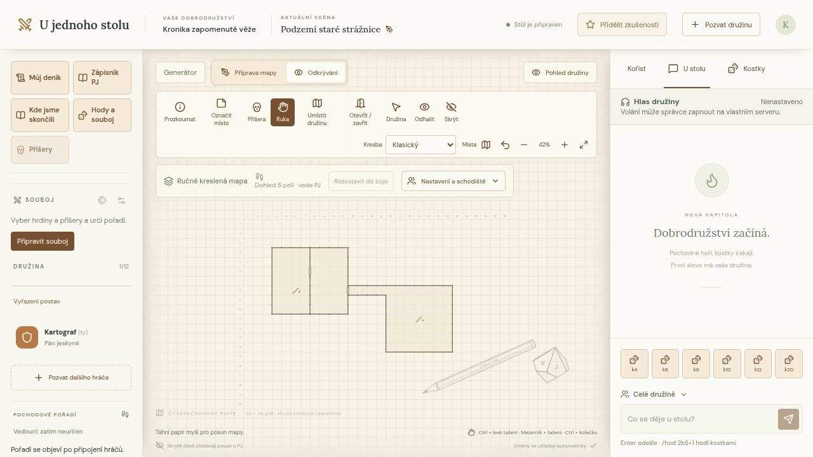 | 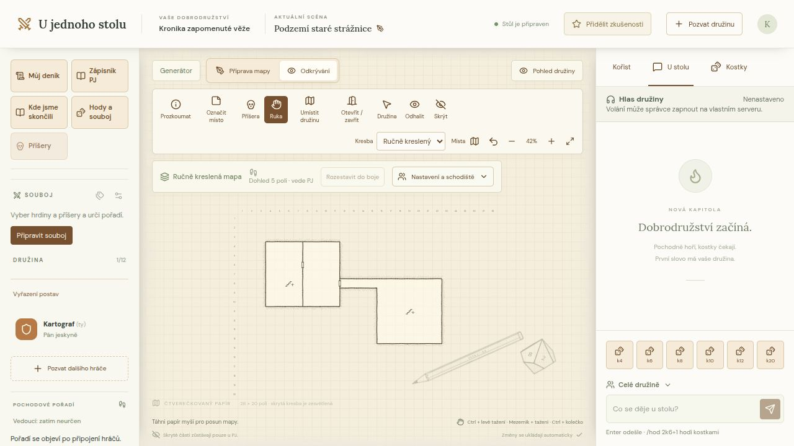 |
| Generátor: stejný podklad, navíc přípravná čísla, hlavní trasa a cíl | 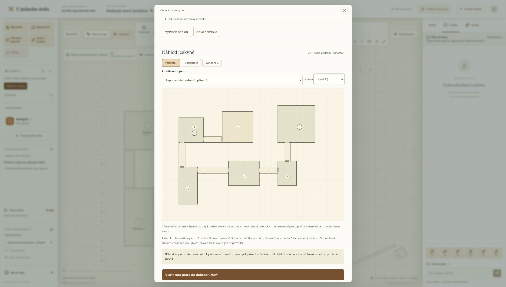 | 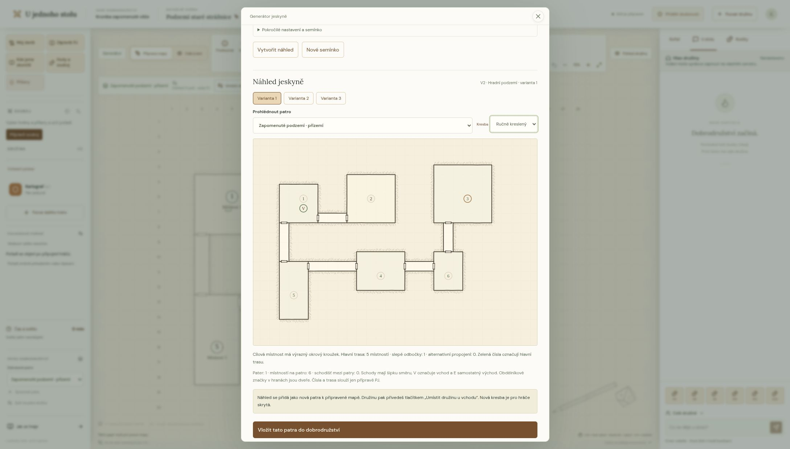 |

Horní panel sjednocuje režim, vzhled, přiblížení a skupiny kreslicích nástrojů. Na užší obrazovce se přehledně zalomí.

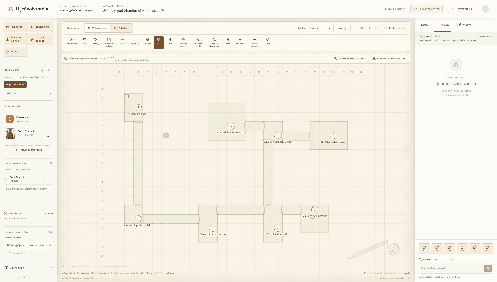

## Rozdělení kódu

| Soubor | Odpovědnost |
| --- | --- |
| [dungeon-map.tsx](../components/dungeon-map.tsx) | Přepínač vzhledu a sestavení již povoleného pohledu mapy. |
| [use-map-appearance.ts](../components/dungeon-map/use-map-appearance.ts) | Místní preference, bez serverového ukládání. |
| [canvas.tsx](../components/dungeon-map/canvas.tsx) | Společné SVG, tokeny, poznámky, značky, schody a stávající události. |
| [generator-preview-map.tsx](../components/generator-preview-map.tsx) | Náhled používající stejné renderery, doplněný o přípravné značky a trasu. |
| [appearance-control.tsx](../components/dungeon-map/renderers/appearance-control.tsx), [symbols.tsx](../components/dungeon-map/renderers/symbols.tsx) | Společný přepínač vzhledu a symboly schodů. |
| [classic.tsx](../components/dungeon-map/renderers/classic.tsx) | Původní podlahy, zdi a dveře, vyčleněné z plátna. |
| [hand-drawn.tsx](../components/dungeon-map/renderers/hand-drawn.tsx) | Inkoustové podlahy, kontury, šrafy a symboly dveří. |
| [geometry.ts](../components/dungeon-map/drawing/geometry.ts) | Čisté odvození kontur, tlaku pera, směru šraf a ořezu z dostupné geometrie. |
| [noise.ts](../components/dungeon-map/drawing/noise.ts), [palettes.ts](../components/dungeon-map/drawing/palettes.ts) | Stabilní vizuální odchylky a čtyři varianty rukopisu. |

Obsluha vstupu v `use-map-input.ts` se nemění. Dekorativní vrstvy mají `pointer-events: none`; souřadnice a průchodnost vycházejí stále z přesné mřížky, nikoli z vykreslené křivky. Generátor V1/V2, jeho PRNG, data `Dungeon` i zálohy se nemění. SVG nepotřebuje další knihovnu, rastrové textury ani internet.

## Jak kresba vzniká

- Hrany se stabilně seřadí a v místech se dvěma sousedy spojí do kontur. Křivky mají společné přesné konce; malé odchylky řídicích bodů a přítlak jsou odvozené z klíče hrany. Otevření dveří nezmění kresbu ostatních stěn.
- Šrafy vycházejí ze skutečné podlahy sousedící s hranou. Pokud je podlaha na obou stranách nebo na žádné, jednostranné šrafy se nekreslí. Ořez s pravidlem evenodd navíc vyloučí všechny dostupné podlahy, včetně blízké jiné místnosti.
- Šrafy i detaily se slučují podle průhlednosti do několika cest. Pohyb myši a poll se stejným obsahem neobnovují výpočet kontur: memoizace používá kanonický klíč geometrie, metadat a viditelnosti. Pan a zoom mění transformaci, nikoli náhodné odchylky. Každé SVG má vlastní ID ořezu přes React `useId`.
- Hrad/důl/jeskyně se použijí jen po ověření platných metadat existujícím validátorem V2. Chybějící, změněná nebo vadná metadata znamenají univerzální styl. Soukromá metadata hráč nedostává, proto také používá univerzální kresbu.
- Renderer dostává pouze již filtrovaný pohled. Neobjevené tajné dveře jsou v něm obyčejná zeď; neexistuje zvláštní skrytá dekorace. Osvětlení mění intenzitu známých hran a podlah, dříve navštívené místo zůstává šedé. Kresba sama nic neodhaluje.

## Ověřování a omezení

`npm test` zahrnuje [regrese kresby](../scripts/test-map-drawing.mjs): shodný výstup po serializaci a přeuspořádání dat, všechny směry šraf, vnitřní příčky, stavy dveří, totožnost tajných dveří se zdí v hráčském pohledu, skryté rozšíření, mlhu, tmu, neměnnost mapy a fallback metadat. [Test skutečného React náhledu](../scripts/test-generator-preview.mjs) navíc kontroluje shodu kontur s herním plátnem, V1/V2, zachování podlahy/značek/schodů/vchodů, neměnnost návrhu a unikátní SVG ID více náhledů. Společné kontroly jsou `npm run verify`, `npm run build:node` a `npm run build`.

Kresba je stylizací stávající mřížky 28 × 20, nepřidává novou topologii. Při silném oddálení záměrně splývají jemné šrafy; pro detail přibliž mapu. Čísla místností mají v inkoustovém režimu větší písmo. Herní tokeny a poznámky si zachovávají dosavadní rozlišení. Náhled generátoru používá stejné podlahy, kontury, šrafy, dveře a symboly schodů jako herní mapa. Přepínače **Vzhled mapy** a **Vzhled náhledu** sdílejí místní preferenci a změna se projeví okamžitě v obou. Čísla, zelené označení hlavní trasy, okrový kroužek cíle a V/E zůstávají přípravnou vrstvou PJ; přepnutí nevyžaduje nové generování a nemění vybranou variantu ani patro.

Při místním ověření byly v obou vzhledech vyzkoušeny dveře, posun, zoom, kreslení z klávesnice a undo. Rozpracovaná místnost šla dokončit po přepnutí vzhledu; obnovení stránky zachovalo volbu. Hráčský náhled používal univerzální kresbu a šedou paměť bez soukromých čísel místností. Orientační měření 100 výpočtů extrémní ruční mapy s 1 168 hranami dalo průměrně 7,7 ms na výpočet; nejde o časový limit CI ani garanci na jiném zařízení.

Výtvarnou inspirací jsou obecné postupy tradiční kartografie a [One Page Dungeon od Watabou](https://watabou.itch.io/one-page-dungeon). Implementace, šrafy a SVG jsou původní; nepřebírají jeho kód, grafické podklady ani konkrétní mapy.
