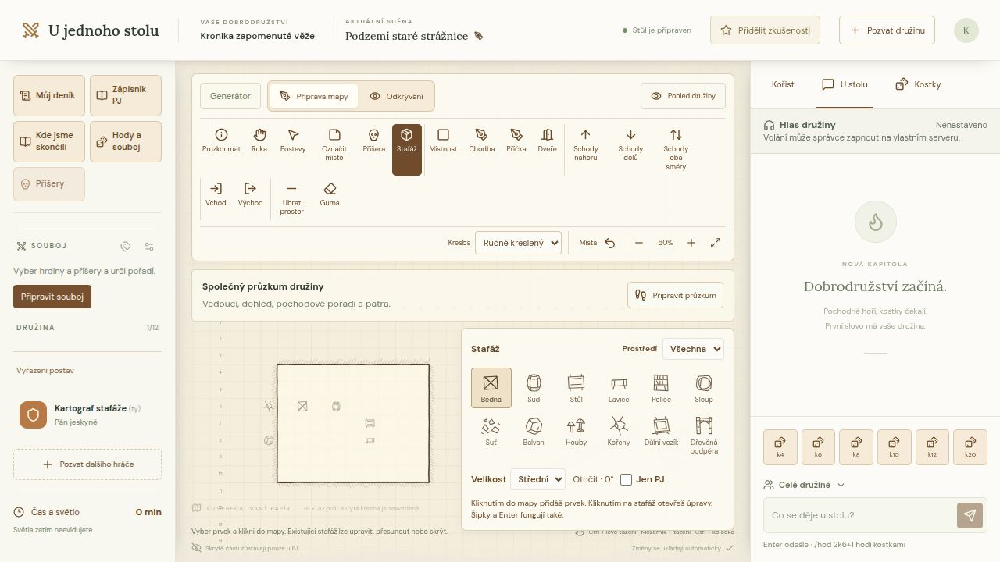
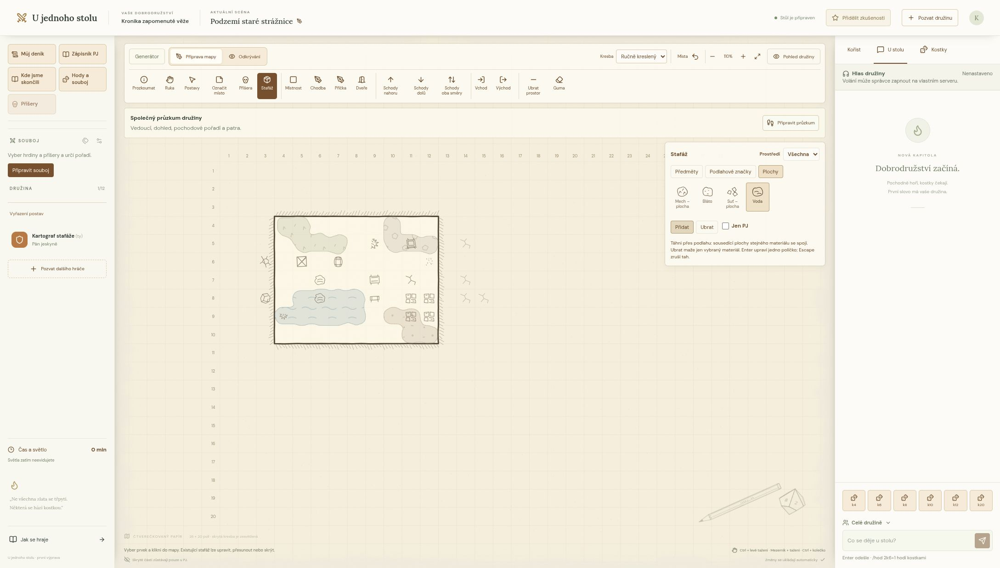
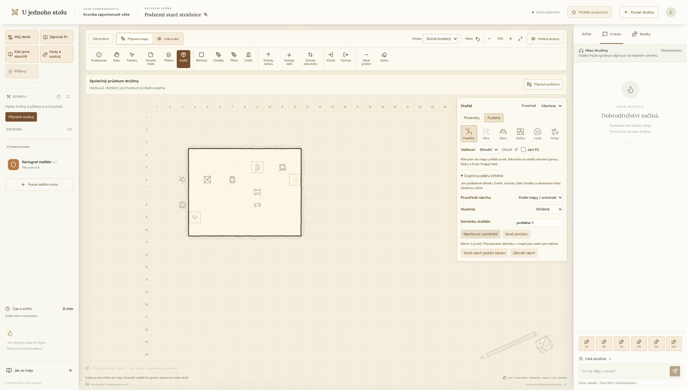

# Stafáž mapy

Nástroj **Stafáž** je dostupný PJ v přípravě i odkrývání. Paleta odděluje **Předměty**, **Podlahové značky** a **Plochy**. Dvanáct původních tušových symbolů zahrnuje bednu, sud, stůl, lavici, polici, sloup, suť, balvan, houby, kořeny, důlní vozík a dřevěnou podpěru. Šest podlahových detailů přidává praskliny, louži, hlínu, dlažbu, mech a střepy. Filtrem **Prostředí** vybereš hrad, důl nebo jeskyni; filtr je doporučení, ne pravidlo umístění.



## Umístění a úpravy

1. Vyber symbol, malou/střední/velkou velikost a otočení po 90°. Volba **Jen PJ** založí skrytý prvek.
2. Klikni do políčka mapy, případně použij šipky a Enter. Každé vložení je samostatný tah. Prvek může být uvnitř i vně půdorysu v rámci mřížky 56 × 40.
3. Ve zvoleném nástroji klikni na existující symbol nebo na jeho políčku stiskni Enter. Otevře se editor velikosti, otočení, skrytí a poznámky PJ do 1000 znaků.
4. Pro přesun nejdřív ulož rozepsané změny. **Přesunout v mapě** čeká na nové políčko; umístění potvrdí kliknutí nebo Enter. Přesun lze zrušit v paletě, klávesou Escape nebo změnou nástroje. Přepnutí na jiné patro přesun mezi patry neprovede.
5. **Odstranit stafáž** prvek odebere. Vložení, úpravu, přesun i odstranění lze vrátit běžným **Zpět**, v rámci společné historie mapy.

Na jednom políčku je jeden prvek a na patře nejvýše 200. Změny stávajícího prvku kontrolují jeho revizi (nový neprůhledný token při každém uložení, bezpečný i po Zpět); při souběhu server vrátí konflikt a editor ponechá rozepsané údaje. Poznámka se hráčům neposílá. Další nástroj, například Ruka, paletu zavře a běžné hraní pokračuje.

## Viditelnost a herní význam

Stafáž neblokuje pohyb, nemění zdi, dveře, osvětlení ani metadata generátoru V2. Klasický a ručně kreslený vzhled používají stejné symboly, slabší než hlavní kontury. Herní značky, postavy a příšery zůstávají nad dekoracemi. Mimo nástroj Stafáž jsou dekorace neinteraktivní.

Vnitřní prvek hráč pozná po odhalení svého políčka. Vnější prvek patří k bezprostředně sousedící podlaze; objeví se po odhalení alespoň jednoho takového políčka. Izolovaná dekorace bez sousední podlahy zůstává jen v přípravě PJ. Jde o kartografický detail okolní skály, nikoli o samostatný průhled skrze stěnu.

Při automatickém průzkumu se ukládá pouze skutečně viděná podoba. Přesun, odstranění nebo skrytí mimo dohled se do hráčské paměti nepromítne před dalším spatřením místa. Nově skrytý prvek, který už hráči dříve viděli, tak mohou stále znát ze šedé paměti. Změna tajné poznámky se neprozradí ani pomocí revize. PJ může odhalování řídit také ručně, stejně jako dosud.

Změna podlahy stafáž nemaže: může se stát vnější nebo izolovanou značkou. PJ ji může následně přemístit či odstranit. Fyzické překážky, interaktivní truhly a vazby na kořist nejsou součástí stafáže.

## Organické plochy



Filtr **Prostředí** platí i pro plochy: voda a suť patří do všech tří prostředí, bláto do dolu a jeskyně, mech do hradu a jeskyně. Volba **Všechna** nabídne všechny čtyři materiály. Jde o doporučení pro výběr, existující kresbu změna filtru nepřevádí ani nemaže.

Ve **Stafáž → Plochy** vyber vodu, bláto, mech nebo suť. Táhni přes podlahu: sousední části stejného materiálu se spojí do jedné nepravidelné kresby s jemnou výplní a texturou. Během tažení vidíš náhled; uvolnění myši uloží celý tah, **Escape** jej zruší a **Zpět** vrátí jedním krokem. Šipky a Enter přidají nebo uberou jedno políčko. Ctrl nebo mezerník s tažením nadále posouvá mapu.

**Přidat** kreslí materiál a na zasaženém políčku případně nahradí jiný materiál. **Ubrat** odstraňuje pouze vybraný materiál. Plocha se může nacházet pod předměty, poznámkami, postavami i příšerami. Volba **Jen PJ** funguje také pro celý tah. Plochy nemají otáčení ani velikost symbolu; otočení předmětů je schované v rozbalovací volbě a zůstává dostupné i v editoru.

Políčka určují umístění štětce, nikoliv výsledný obrys. Kresba vzniká ze spojitého pole pigmentu, zaobleného obrysu a řídkých tušových značek různé velikosti a natočení ukotvených na papíře; při překreslení se náhodně nemění. Na volné sousední podlaze může okraj mírně přesáhnout políčko štětce. Podlaha, zdi a dveře kresbu oříznou; diagonálně se dotýkající ostrůvky zůstávají oddělené. Při rychlém diagonálním tažení štětec doplní navazující políčka.

Je to dekorace: voda neblokuje cestu ani automaticky nezpůsobuje uklouznutí. Herní význam určí PJ. Na políčku je nejvýše jeden plošný materiál, vedle něj může být běžná stafáž. Limit je 560 políček na patro. Odebrání podlahy odstraní také plochu na ní; Zpět vrátí obojí. Staré podlahové symboly se na plochy automaticky nepřevádějí a náhodný návrh zatím vytváří jednotlivé značky, nikoli plochy; natřené podlahové buňky při tom vynechá.

Hráč dostává pouze materiál na spatřených políčkách. Neposílá se celý obrys tajné oblasti. Kresba se sestavuje z jeho známé mapy, změny mimo dohled zůstávají v paměti a navštívené části se tlumí. Jen PJ vidí skryté plochy.

## Střídmé automatické rozmístění



V paletě rozbal **Doplnit podlahu střídmě**. Vyber prostředí, hustotu a semínko, potom vytvoř náhled. Přerušované rámečky jsou pouze soukromý návrh PJ; do mapy ani hráčům se zatím nic nezapíše. **Vložit návrh jedním tahem** přidá celou sadu jedním tahem, který lze vrátit jedním **Zpět**. Návrh lze také zahodit. Volba **Jen PJ** se vztahuje i na novou sadu.

Stejná mapa, obsazená políčka, katalog, parametry a semínko dávají stejný návrh. **Nové semínko** nabídne jiné rozmístění. Automatické prostředí používá styl platných metadat V2; u ruční mapy či neplatných metadat vybírá ze všech prostředí. Výslovnou volbou prostředí lze výběr omezit.

Návrh používá jen podlahové detaily s `automatic: true`. Zachovává ruční stafáž, vynechává obě strany dveří, schody, vchod, východ, značky poznámek, umístěné příšery a postavy. Vyžaduje alespoň tři podlahové sousedy a mezi novými prvky nechává rozestup; úzké rovné chodby tak zůstávají volné. Hustoty jsou nejvýše 10/20/30 prvků a přibližně 4/8/14 % podlahy, vždy v celkovém limitu 200. Pro některé mapy nemusí být vhodné místo.

Server návrh znovu vypočítá z aktuálních dat. Změna kresby, stafáže nebo obsazení zneplatní připravený návrh; vytvoř nový. Změny se neaplikují částečně. Algoritmus nespotřebovává náhodná čísla generátoru jeskyní a nemění jeho půdorys.

## Komunitní katalog

Všech 22 definic (18 symbolů a 4 plošné materiály) má vlastní JSON v [content/scenery](../content/scenery). Přidání nevyžaduje úpravu komponent ani seznamu typů. Zkopíruj například [moss.json](../content/scenery/moss.json), zvol nové stabilní ID a stejné jméno souboru:

```json
{
  "id": "worn-tiles",
  "name": "Ošlapaná dlažba",
  "category": "floor",
  "environments": ["castle"],
  "automatic": true,
  "path": "M4 7 L14 7 L14 15 L4 15 Z M17 17 L27 17 L27 25 L17 25 Z"
}
```

- `category` je `object` nebo `floor`. Prostředí jsou `castle`, `mine`, `cave`, alespoň jedno a bez opakování.
- `automatic` je výslovný souhlas s náhodným rozmístěním; výchozí hodnota je `false`. `true` je povoleno jen pro podlahu. Nové definice se do příslušných filtrů i automatického návrhu zařadí samy.
- `path` obsahuje pouze SVG příkazy a číselné souřadnice pro plátno **32 × 32**. Symbol je tvořen nevyplněnými tahy, barvu, průhlednost a tloušťku řídí společná vrstva. Nekopíruj celé SVG, HTML, skripty, styly, odkazy ani externí obrázky. Validace je odmítne. Limit je 6000 znaků; pro čitelnost doporučujeme několik jednoduchých tahů uvnitř okraje 2–30.
- Zachovej tichý tušový vzhled bez barevného pozadí. Ověř symbol v malé velikosti, v obou vzhledech mapy a v šedé paměti. Uveď původ kresby a licenci v PR podle [pravidel přispívání](../CONTRIBUTING.md#licence-a-původ-obsahu).

### Vlastní plošný materiál

Zkopíruj [water-area.json](../content/scenery/water-area.json). Vedle běžných polí definuj:

```json
"surface": {
  "color": "#998b78",
  "texture": "speckles",
  "roughness": 0.7
}
```

Plocha má `category: "floor"` a `automatic: false`. `path` zůstává ikonou v paletě; kresbu mapy tvoří sdílený organický renderer. Barva musí být šestimístný hexadecimální odstín, textura jedna z `ripples` (vlnky), `speckles` (tečky), `strokes` (krátké tahy), `stones` (kamení). `roughness` je 0–1 (výchozí 0,5). Používej tlumené odstíny pro čitelnou mapu. Nový JSON se sám objeví v **Plochách** i filtrech prostředí; žádná komponenta se neupravuje. Vlastní skripty, CSS, odkazy a libovolné SVG textury nejsou podporované.

ID materiálu zůstává zachované i při obnově bez definice; chybějící plocha použije neutrální odstín a texturu. Pro původní vzhled je potřeba vrátit definici do katalogu a aplikaci sestavit.

Spusť `npm run content:sync`, `npm run check:content` a `npm test`. Do PR zahrň JSON, vygenerovaný `index.ts` a snímek použití na mapě. Kontrola hlásí soubor a neplatné pole. Další obsah popisuje [komunitní průvodce](OBSAH.md).

Použité ID nepřejmenovávej a nemaž. Mapa ukládá ID, nikoliv kopii kresby. Pokud vlastní katalog při přenosu zálohy chybí, zobrazí se neutrální značka s otazníkem; původní ID a údaje zůstanou zachovány. Prvek lze přesunout, upravit nebo odstranit. Pro jeho nové vkládání a správnou kresbu musí provozovatel doplnit definici a aplikaci znovu sestavit. Katalogy se z cizích serverů automaticky nestahují.

## Data a vývoj

Volitelné `Dungeon.surfaces` obsahuje `{kind, x, y, hidden?}` po jednom materiálu na buňku. Akce `map`, `tool: "surface"`, `kind`, `op: "add" | "remove"`, `points`, `hidden`, `levelId`, `requestId` ukládá jeden tah. Souběžné tahy se zpracují nad aktuální mapou; na stejném políčku rozhoduje poslední zápis.

Volitelné `Dungeon.scenery` obsahuje `{id, kind, x, y, rotation, size, hidden?, note?, revision?}`. Uložení používá existující akci `map`, nástroj `scenery`, operaci `save` nebo `remove`, `requestId`, a při úpravě `sceneryId` a `expectedRevision`. První vložení používá `expectedRevision: null`. Bezpečné opakování a historii zajišťuje běžná mapová transakce; hráčský zápis server odmítá.

- [lib/scenery-catalog.ts](../lib/scenery-catalog.ts): validovaný komunitní katalog.
- [lib/scenery.ts](../lib/scenery.ts): validace uložených prvků, úpravy a projekce do paměti.
- [lib/surfaces.ts](../lib/surfaces.ts), [lib/surface-drawing.ts](../lib/surface-drawing.ts): štětec, paměť, spojování a stabilní organický obrys.
- [lib/scenery-fill.ts](../lib/scenery-fill.ts): deterministický návrh, obsazenost a kontrola změn.
- [glyph.tsx](../components/scenery/glyph.tsx): vykreslení ověřené cesty z katalogu, sdílené mapou a paletou.
- [layer.tsx](../components/scenery/layer.tsx): neinteraktivní dekorativní vrstva a útlum podle dohledu.
- [palette.tsx](../components/scenery/palette.tsx), [editor.tsx](../components/scenery/editor.tsx): výběr a soukromé úpravy PJ.
- [test-surfaces.mjs](../scripts/test-surfaces.mjs), [test-surfaces-api.mjs](../scripts/test-surfaces-api.mjs): organický štětec, souběžně navazující tahy, skrytí, paměť a zálohy.
- [test-scenery-core.mjs](../scripts/test-scenery-core.mjs): typy, geometrická nezávislost, paměť, Zpět a kompatibilita generování v `npm test`.
- [test-scenery-fill.mjs](../scripts/test-scenery-fill.mjs): automatický návrh, komunitní definice, limity a hromadné Zpět.
- [test-scenery.mjs](../scripts/test-scenery.mjs): oprávnění, souběh, opakování, skrytí, paměť a úplné zálohy v obou integračních sadách.

Paměť ukládá jen veřejná vizuální pole; soukromé údaje se neskrývají pouze CSS. Může uchovat až 560 historických značek po jedné na políčko. Validační schéma odmítne tajné údaje v paměti. Záloha formátu 1 podporuje nová volitelná pole ve všech mapách a jejich historiích. Staré zálohy bez stafáže zůstávají platné, SQL migrace se nemění. Pro zachování nové stafáže při obnově používej verzi aplikace, která ji podporuje.
