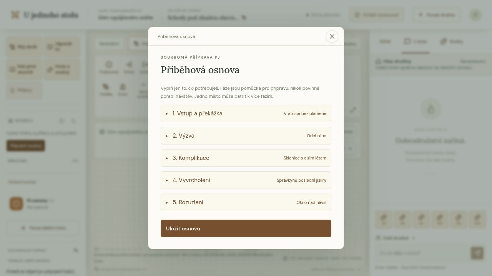

# Příběhová osnova

**Zápisník PJ → Příběhová osnova** je soukromá pomůcka k přípravě. Pět rozbalovacích karet představuje vstup a překážku, výzvu, komplikaci, vyvrcholení a rozuzlení. Každá má vlastní krátkou nápovědu, nepovinný nadpis, poznámku PJ a označení **Odehráno**. Vyplň jen užitečné části a stiskni **Uložit osnovu**. Hráči osnovu ani její vazby nedostávají.



## Propojení s mapou

V kartě otevři **Přiřadit místa** a označ existující poznámky z libovolného patra. Jedna fáze může mít více míst, jedno místo více fází. Tlačítko **Otevřít přípravu** načte aktuální poznámku a její patro, včetně situace pro družinu a tajné přípravy. Přechod z rozepsané osnovy chrání běžný dialog neuložených změn.

U vlastní mapy nejprve přidej poznámky nástrojem **Označit místo**, nebo vlož jeskyni generátorem. Osnova funguje i u ručních map, V1 a starých kampaní. Žádný nový začátek dobrodružství není potřeba.

Vazba vede na stabilní `MapNote.id`, nikoli na číslo místnosti nebo index generátoru. Přesun značky a přečíslování ji zachovají. Odstranění poznámky odebere její ID ze všech fází a zvýší revizi osnovy; texty i příznaky odehrání zůstanou. Ruční změna geometrie a zneplatnění metadat V2 osnovu nemažou.

## Komunitní předlohy

Pole `rooms[].phase` v současném JSON formátu zůstává nepovinné. Při založení hry se příslušné fáze propojí s nově vytvořenými poznámkami. Nadpis se převezme z prvního místa dané fáze; při opakování fáze se zachovají všechny odkazy. Plné texty všech událostí zůstávají v jejich poznámkách, nic se neslučuje ani nekrátí. Předlohy bez `phase` vytvoří běžnou hru bez uložené osnovy.

Původní ukázka [Dům vypůjčeného světla](https://github.com/cert4u/u-jednoho-stolu/blob/main/content/adventures/dum-svetla.json) používá [osm komnat](https://github.com/cert4u/u-jednoho-stolu/blob/main/content/dungeon-presets/lucerna.json) a všech pět fází, některé opakovaně. Problém světla a zapůjčených vzpomínek lze řešit opravou, dohodou nebo jinou cestou, kterou navrhne družina. Vyvrcholení nemusí být soubojem a další výprava není povinná.

## Data, soukromí a rozšiřování

Jedno volitelné pole `Game.storyOutline` obsahuje:

```typescript
{
  revision: number;
  phases: Partial<Record<StoryPhase, {
    title: string;     // nejvýše 100 znaků
    notes: string;     // nejvýše 3000 znaků
    noteIds: string[]; // unikátní ID, nejvýše 200 na fázi
    played: boolean;
  }>>;
  operations?: string[]; // posledních 256 requestId pro bezpečné opakování
}
```

[story-phases.ts](https://github.com/cert4u/u-jednoho-stolu/blob/main/lib/story-phases.ts) definuje společný typ a schéma fází pro komunitní předlohy, editor i zálohu. [story-outline.ts](https://github.com/cert4u/u-jednoho-stolu/blob/main/lib/story-outline.ts) spravuje uložení, projekci a odstranění zaniklých vazeb. [Editor](https://github.com/cert4u/u-jednoho-stolu/blob/main/components/story-outline-panel.tsx) používá existující registr dialogů a běžné herní API.

Akce `story-outline` je povolená pouze PJ. Vyžaduje `requestId`, `expectedRevision` (`null` před prvním uložením) a neprázdný objekt `phases`. Dodané fáze nahrazují své předchozí hodnoty, ostatní zůstanou. Chybějící pole fáze dostanou prázdné výchozí hodnoty. Konflikt revize nebo zaniklý odkaz vrací 409, neplatný vstup 400, hráčský zápis 403. Revize chrání celou osnovu: i dvě současné úpravy různých fází vyžadují vědomé sladění.

Pohled PJ obsahuje `storyOutline: {revision, phases, places}`; `places` je aktuální seznam názvů, ID a kotev poznámek napříč patry, bez kopírování jejich textů. Hráčská odpověď klíč vůbec neobsahuje. Přístup k úplné záloze zůstává pouze PJ.

Záloha verze 1 má kompatibilně rozšířené validační schéma; chybějící osnova je platná. Obnova zachovává texty, odehrání i vazby na zachovaná ID poznámek. Záloha s odkazem na neexistující poznámku se odmítne. SQL migrace se nemění.

## Ověření a hranice

[Integrační sada](https://github.com/cert4u/u-jednoho-stolu/blob/main/scripts/test-story-outline.mjs) pokrývá vlastní kampaň, jednotlivé i současné úpravy, opakování požadavku, mnohočetné vazby napříč patry, přesun/přečíslování/odstranění poznámky, staré kampaně a předlohy, opakované fáze, soukromí, úplné zálohy a zachování přípravy po změně geometrie. Spouští se v `npm run test:hosting` a `npm run test:ci` jako součást herní integrační sady.

Osnova nemění průchodnost, generování, světlo ani pohyb družiny. Odehrání se označuje ručně, nic se automaticky neodemyká. Nemá AI, podmínky úkolů ani automatický postup. V této etapě se fáze neznačí přímo v mapě: čísla místností a herní značky zůstávají přehledné.

Dramaturgickou inspirací je [Five Room Dungeon od Johnna Foura, Roleplaying Tips](https://www.roleplayingtips.com/5-room-dungeons/). Kód, české nápovědy a ukázkové dobrodružství jsou vlastní; texty a dobrodružství z publikovaných sbírek nepřebíráme.
